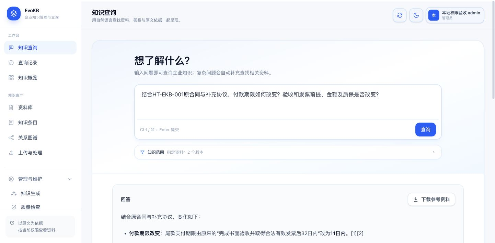
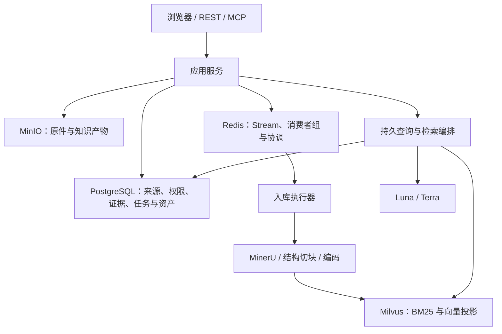

<div align="center">

# EvoKB

**把企业资料整理成有原文依据、可追溯、按权限使用的知识。**

原件与版本 · 结构切块 · 混合检索 · 自然语言问答 · 稳定知识条目

[](java/pom.xml)
[](web/package.json)
[](LICENSE)

[快速开始](#快速开始) · [架构](#架构) · [开发与验证](#开发与验证) · [当前状态](#当前状态)

</div>

EvoKB 面向合同、报告与尽调资料。原件、版本、来源权限和证据是知识资产的基础；摘要、稳定条目、Wiki 与图谱保留来源关系。用户用自然语言查询，查看回答引用的原文，或在资料库浏览处理结果。

## 使用流程

1. 管理员配置模型与解析服务，建立使用者及资料权限。
2. 上传原件并确认资料信息；大文件支持分片上传与续传。
3. 在入库记录查看解析、结构切块、索引和失败重试状态。
4. 用自然语言查询，补充必要信息，查看引用与对应原件位置。
5. 通过资料库、知识条目与图谱浏览来源、版本及当前有效知识。
6. 管理员查看知识生成、质量检查、模型服务和审计。



## 核心能力

| 领域 | 能力 |
| --- | --- |
| 原件与入库 | 版本、元数据、访问范围、16 MiB 分片续传、独立 MinerU 解析 |
| 切块与缓存 | 真实 tokenizer 结构切块；完整编码输入与模型身份参与缓存键 |
| 任务与恢复 | PostgreSQL 持久任务、Redis Stream / PEL、owner / epoch / deadline 栅栏 |
| 检索与问答 | Milvus BM25 + Vector、检索预算、澄清、原文引用与资料包 |
| 知识资产 | 摘要、稳定条目、Wiki、图谱、来源变更与权限失效处理 |
| 企业工作台 | 资料、历史、入库、知识生成、质量、审计和用户权限 |

主模型使用 **gpt-5.6-luna / gpt-5.6-terra**；本地编码与重排使用 **Qwen3-VL-Embedding-2B / Qwen3-VL-Reranker-2B**。缺少模型或 tokenizer 时明确记录不可用，不用虚构答案或字符估算冒充真实闭环。

## 架构



Java 五模块区分领域、应用、基础设施、接口和装配。同步与后台入库共用一个受管执行器；查询控制器、HTTP 契约和证据权限映射分开。前端按认证、查询、入库、资产与管理划分 API，统一导航和原生弹窗，集中处理焦点、取消与错误状态。

## 快速开始

需要 Docker Compose v2。开发使用 JDK 17、Maven、Node.js 24 与 npm。

```sh
git clone https://github.com/lgs0809/EvoKB.git
cd EvoKB
cp .env.example .env
# 在本机填写 PostgreSQL / MinIO 密钥；按需配置模型与 MinerU
make compose-config
make up
```

默认页面为 **[http://127.0.0.1:18080/enterprise/ask](http://127.0.0.1:18080/enterprise/ask)**。默认部署使用 PostgreSQL、Milvus、Redis、MinIO 与应用容器，发布端口均绑定本机。首次从页面建立管理员，随后配置资料权限。外部模型与 MinerU 不会自动下载或启动；未连接时相应能力不可用。配置步骤见 [默认部署](deploy/default-deployment.md)。

```sh
# 停止运行，保留容器和数据卷
make stop
```

当前隔离验收页面为 **[http://127.0.0.1:18481/enterprise/ask](http://127.0.0.1:18481/enterprise/ask)**，沿用独立 target 依赖和数据。初始化、业务资料、检查 SQL 和受测产物部署见 [本地环境说明](deploy/target/README.md)。默认部署使用独立项目名，不会迁移或覆盖验收数据。

## 开发与验证

```sh
mvn -f java/pom.xml clean verify
cd web && npm ci && npm run lint && npm run typecheck && npm run build
cd .. && node scripts/release-hygiene.mjs
make compose-config
```

受测产物记录使用 `scripts/verify-backend.py`，target 部署使用 `scripts/deploy-target.py`。真实组件脚本见 [脚本说明](scripts/README.md)，复跑步骤见 [验收入口](deploy/target/README.md)。每次使用新报告，保留失败与实际产物身份。

```text
java/
  ekb-domain/              领域契约与规则
  ekb-application/         入库、检索、查询、编译与身份
  ekb-infrastructure/      存储、模型与解析适配
  ekb-interfaces/          HTTP / MCP 入口及响应契约
  ekb-bootstrap/           Spring 装配、配置与迁移
web/src/
  enterprise/              企业工作台、导航和共享弹窗
  lib/api/                 领域 API、传输与类型契约
deploy/                    默认部署、隔离验收及合成资料
scripts/                   初始化、部署、真实组件与只读核对
docs/                      结构、方案及验收边界
```

## 当前状态

结构重构回归 **287 通过、1 项真实模型测试跳过、0 失败**，已正常部署。页面与实际权限读回另行验收。Stream 的 30 个独立组件案例、结构切块的 360 个离线案例已有通过记录，两者不等于真实模型质量通过。

仍有问题：多页扫描 / 跨页表格解析超时，部分问答依赖中断与摘要事实质量未达标，正式问答集未完成。真实 Hash 小对照没有显著耗时收益，完整 100 份对照及部分长期升阶未测。详见 [验收状态](deploy/target/README.md)、[切块与 Hash 实验](deploy/target/chunk-and-hash-experiments.md) 和 [解析限制](deploy/mineru/README.md)。

## License

[MIT License](LICENSE)。
