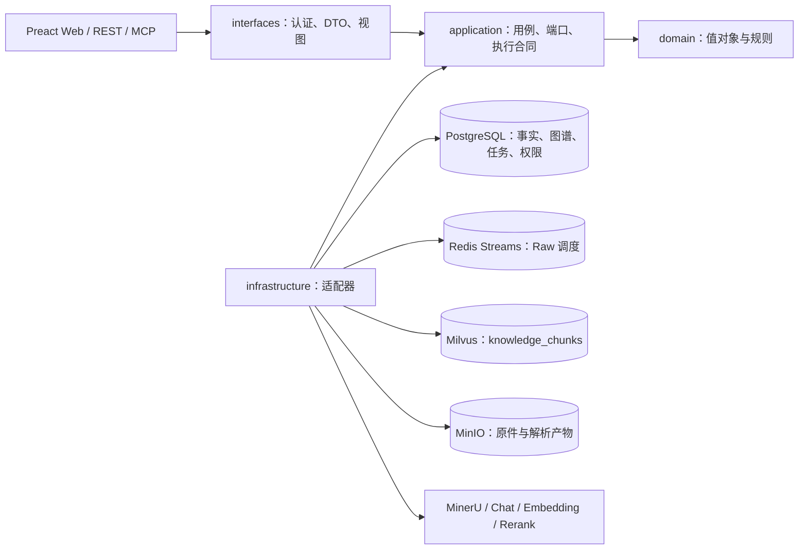

# 架构说明

EvoKB 是 Java DDD 模块化单体。当前主部署使用 PostgreSQL、Redis Streams、Milvus 与 MinIO；旧 MySQL/OpenSearch/Neo4j 适配器和部署只保留用于历史排查，不参与默认装配。

`ekb-bootstrap` 是 Spring 装配根，管理配置、Flyway、Bean 和后台生命周期。ArchUnit 检查 domain 不依赖外层或 Spring、application 不依赖 Web/JDBC 适配器、infrastructure 不依赖 interfaces、interfaces 不依赖 infrastructure。

## 资料与执行权

上传先进入可恢复的暂存流程；原件及解析产物保存到 MinIO，PostgreSQL 保存版本、分类和任务事实。Raw worker 通过 Redis Stream/PEL 接收任务，通过 PostgreSQL 的 owner、epoch 与固定期限领取执行权。完成解析、结构切块和编码后，在当前来源权限及执行权校验下发表 Milvus 投影和激活版本，终态才 ACK。消费者死亡、PEL 接管和重复消息不能跳过发表校验。

同步兼容入口和持久 worker 共用 `ClaimedRawIngestionExecutor`；领取任务、attempt、期限、ACK、临时文件清理仍由各入口管理。数据库是任务事实来源，Stream 不作为业务完成状态。后端重启与前端资产发布使用绑定源码、测试和不可变产物的脚本。

## 检索与知识演化

Raw、Summary、Concept、Wiki 共用 Milvus 的 `knowledge_chunks`，通过类型和稳定资产标识区分；图谱及词项事实在 PostgreSQL。生成不作为 Raw 入库完成的前置条件。生成任务保留来源版本、证据、权限、贡献和质量状态，源版本失效会使相关派生产物失效。

查询在持久会话内按预算执行检索、融合、重排、上下文补充和回答。最终引用必须解析到当前有效且获授权的原件。HTTP 查询由 `EnterpriseQueryController`、`QueryHttpContracts` 和共享的 `EnterpriseEvidenceViewAssembler` 处理，历史与续问恢复同一原始范围，客户端不能提交受信任的用户权限。

## 外部服务与前端边界

MinerU 与模型通过适配器接入。当前约定小模型 `gpt-5.6-luna`、大模型 `gpt-5.6-terra`，编码与重排使用 Qwen3-VL-Embedding-2B 1024 维和 Qwen3-VL-Reranker-2B；部署不静默替换模型或下载权重。失败保留持久记录，有界退避仍受总预算约束。

前端 `lib/api` 按认证、查询、入库、资产和管理划分，共享传输与契约；原 `api.ts` 保留导出兼容。导航注册表统一页面标题、链接及权限；原生 `dialog` 统一弹窗焦点、Esc、背景 inert 与移动侧栏。页面直接展示真实任务和失败状态。

部署见 [部署说明](DEPLOYMENT.md)，后端职责见 [后端结构](../deploy/target/backend-structure.md)，验收范围见 [当前记录](../deploy/target/README.md)。
